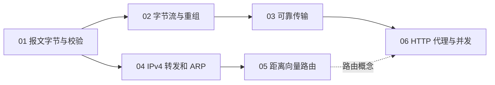

# 课程设计与依赖

箭头表示知识先修，各实验代码独立。各实验自带公共类型、starter 和公开测试；实验 03 独立于实验 02，实验 04 不依赖学生的实验 01。可选跨实验演示展示层间关系，各项评分使用独立实现。

| 设计空间 | 本课选择 | 主要权衡 |
|---|---|---|
| 语言 | Python 3.11 标准库 | 构建简单；不覆盖 C/C++ 内存布局与驱动开发 |
| 状态与时间 | 接口注入时间、离散事件 | 便于边界复现；不模拟所有调度细节 |
| 可靠传输 | 累计 ACK、窗口、固定初始 RTO 和指数退避 | 展示核心机制；无 RTT 估计、握手和完整 TCP |
| 网络层 | 精确定义 IPv4 子集、事件化 ARP | 保留校验和队列；不包含完整网卡及 ICMP |
| 路由 | 有限距离向量与毒性逆转 | 能观察收敛与失效；不实现完整生产路由协议 |
| 应用层 | 真实 socket、并发与缓存 | 引入系统资源和线程；协议子集以实验契约为准 |
| 考核 | 公共与独立隐藏测试、报告 | 检验边界与设计解释，明确测试覆盖范围 |

实现应受公开接口与各实验 README 约束。性能目标以本课程输入及资源上界衡量，不将其他课程的吞吐量直接作为本课指标。
